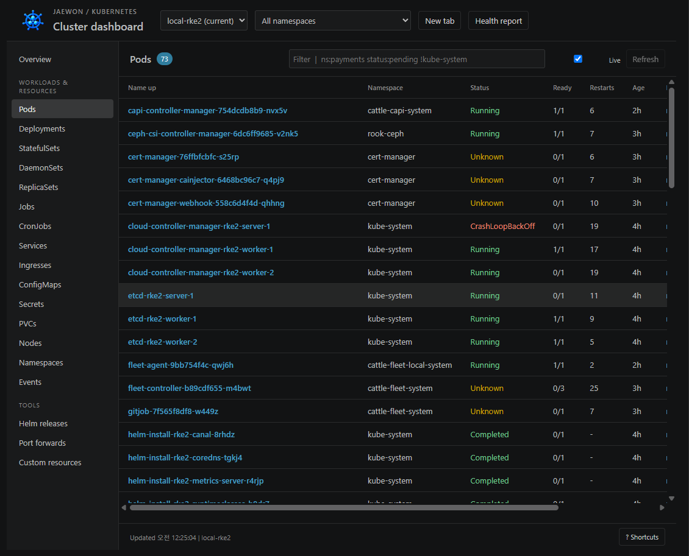
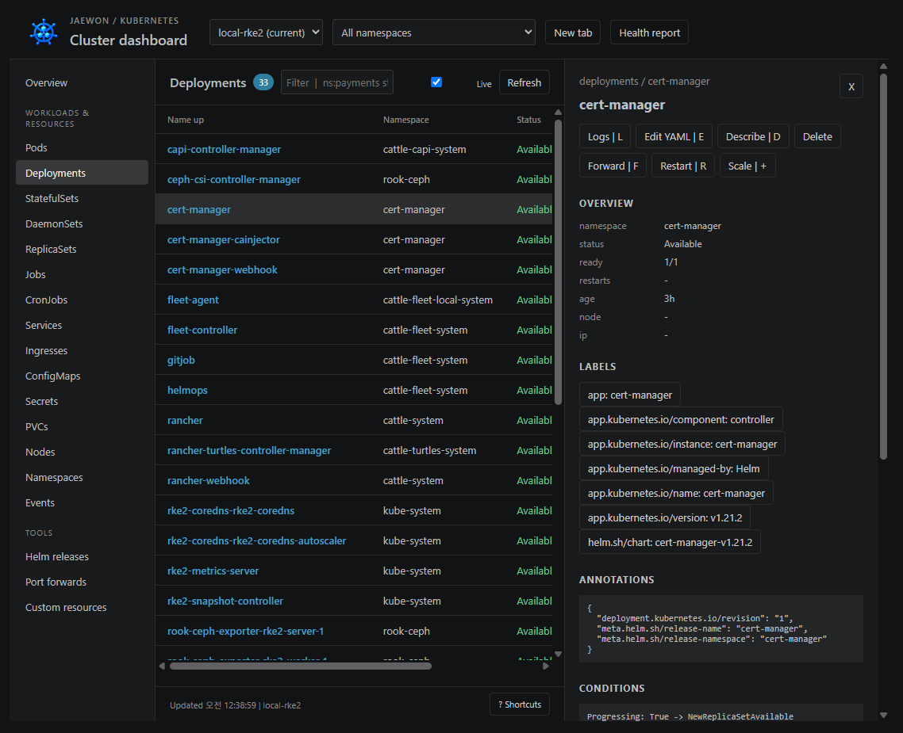
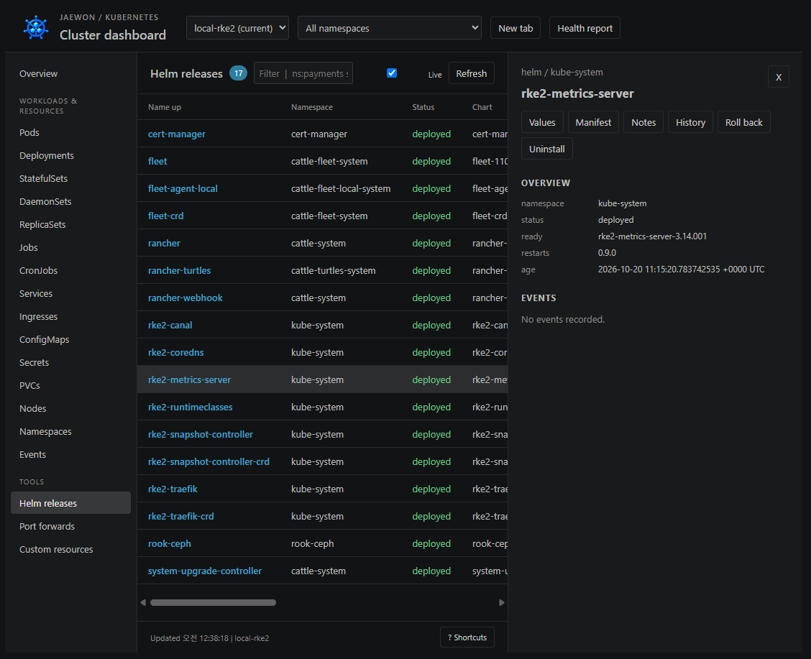

# Jaewon K8s Dashboard

[한국어](https://github.com/david365-lee/jaewon-k8s-dashboard/blob/main/README.md) · [English](https://github.com/david365-lee/jaewon-k8s-dashboard/blob/main/README.en.md) · [日本語](https://github.com/david365-lee/jaewon-k8s-dashboard/blob/main/README.ja.md) · [简体中文](https://github.com/david365-lee/jaewon-k8s-dashboard/blob/main/README.zh-CN.md)

A standalone Kubernetes dashboard that runs inside VS Code.

Created and distributed for free by **jaewon**, a developer from South Korea. Available under the MIT License.

[Install from Marketplace](https://marketplace.visualstudio.com/items?itemName=jaewon-lee.jaewon-k8s-dashboard) · [Download VSIX](https://github.com/david365-lee/jaewon-k8s-dashboard/releases/latest) · [Project overview](https://github.com/david365-lee/jaewon-k8s-dashboard#readme)

## 0.3.2: Multilingual documentation and extension details

The English, Japanese, and Chinese READMEs now follow the same structure as the Korean guide. All three cover quick start, three actual screenshots, feature controls, connection recovery, settings, and analysis scope. Choose a document using the language links at the top.

## 0.3.0: Local and remote clusters and StorageClasses

Use **Connect Local / Remote** to connect through an existing kubeconfig or a remote API endpoint with a bearer token or PEM certificate, private key, and CA. Credentials are stored in VS Code SecretStorage. Create, view, edit YAML, and delete StorageClasses, change the default class, and inspect PV/PVC storage details. The remote API must be reachable over your network; SSH tunnels are not created automatically.

[Connection and storage guide](https://github.com/david365-lee/jaewon-k8s-dashboard/blob/main/docs/remote-storage.md)

## Quick start

1. Prepare VS Code 1.90.0 or later, `kubectl`, and a kubeconfig for the cluster you want to access. Helm features also require `helm`.
2. Search for **Jaewon K8s Dashboard** in the VS Code Extensions view, verify the extension ID `jaewon-lee.jaewon-k8s-dashboard`, and install it.
3. Check your connection in a terminal with `kubectl config get-contexts` and `kubectl get namespaces`.

Run **Jaewon K8s: Open Dashboard** from the Command Palette or press **Ctrl+Alt+J**. You can also manage clusters and port forwards from Jaewon K8s in the Activity Bar.

On macOS, use **Cmd+Alt+J**. If the Activity Bar entry is missing, run **Jaewon K8s: Show Sidebar**.

## Features

### 0.2.4 update

Replaced broken images in the details page with three screenshots from actual use and added guidance for each feature. Published images are served directly by Marketplace, so they are visible without signing in to GitHub. Connection recovery, namespace restoration, and container status improvements are also included.

### 0.2.2 update

- After an initial connection failure, manual or automatic refresh retries connection configuration and namespace discovery.
- Updated extension, dashboard, and tab icons to the new blue cluster image, with a matching Activity Bar icon.
- Shows the cause of a connection failure in the status bar. If the API server or SSH tunnel is down, restore that connection.

### 0.2.0 improvements

Distinguishes current Pod failures from past restart history and accounts for init and sidecar readiness. The detail view shows regular, init, and ephemeral containers, workload templates, and previous termination reasons. Adds dashboard tab restoration, pauses automatic refresh for hidden views, and preserves set-based label selectors when choosing shell targets. The generated icon also appears in the dashboard header and tabs.

[REA in-depth analysis and verification record](https://github.com/david365-lee/jaewon-k8s-dashboard/blob/main/docs/rea-expansion-0.2.0.md)

- Independent tabs per context; namespace selection; resource search, sorting, and pagination
- Pods, Deployments, StatefulSets, DaemonSets, ReplicaSets, Jobs, CronJobs, Services, Ingresses, ConfigMaps, Secrets, PVCs, Nodes, Namespaces, Events, and CRDs
- Containers, conditions, events, labels, annotations, individual Secret keys, CPU/memory history, and resource limits
- Live logs across multiple Pods and containers, previous logs, filters, regular expressions, highlighting, copying, and saving
- Container shells, YAML editing/applying, restart/scale/delete, CronJob run/suspend, and node cordon/uncordon
- Port forwards with automatic reconnection, saving, and automatic startup, bound to `127.0.0.1`
- Helm releases, values, manifests, notes, history, rollback, and uninstall
- Markdown health reports covering failing Pods, restart counts, and workloads/nodes that are not ready

## Screenshot guide

The images below are actual screenshots of the `local-rke2` cluster supplied by the user on October 21, 2026. They show the state at capture time and do not establish the cluster's current health. Resource names, counts, and status vary with the connected environment.

### Explore resources and check status

Select a context and namespace, then search and sort resources. Distinguish current Pod failures from past termination history and check container readiness, restart counts, nodes, and IP addresses.

- **Context / Namespace**: Select the cluster and query scope at the top. Use **New tab** to view another cluster in a separate tab.
- **Status / Ready / Restarts**: Check the current state, ready container count, and cumulative restarts together. A Pod with status `Running` and `Ready` of `0/1` is not ready yet. `Completed` indicates that a job has finished.
- **Unknown / CrashLoopBackOff**: Check node connectivity and container status, then investigate the resource's logs, Describe output, and events. Failure indicators in the screenshot reflect capture time.
- **Search / Refresh**: Combine filters such as `ns:payments`, `status:pending`, and `!kube-system`. Use **Live** for automatic refresh and **Refresh** to query immediately.
- **Health report**: View resources that are not ready and failing Pods in a Markdown report.

### Deployment details and resource actions

Select a name in the list to open the detail panel on the right. The screenshot below shows details for the `cert-manager` Deployment.

- **Overview**: Check the namespace, status, ready replica count, and age.
- **Labels / Annotations / Conditions / Events**: Inspect selectors, Helm management information, workload conditions, and events. The container section shows images, resources, current status, and previous termination reasons for regular, init, and ephemeral containers.
- **Logs / Edit YAML / Describe**: Open logs, edit and apply YAML, or run detailed kubectl diagnostics.
- **Restart / Scale / Delete**: Restart workloads, change replica counts, or delete resources. Available actions depend on the resource type and RBAC permissions.
- **Forward**: Connect a supported resource's port locally. Close the detail view with the panel's **X**.

### Manage Helm releases

Select **Helm releases** on the left to list releases. The screenshot below shows the `rke2-metrics-server` release in `kube-system`.

- **Values / Manifest / Notes**: Open installation values, deployed Kubernetes definitions, and chart usage instructions.
- **History / Roll back**: Review release history and return to a selected revision.
- **Uninstall**: Remove the selected release after confirmation. The `helm` executable and the required permissions must be available for the connected cluster.
- The release list shows namespace, deployment status, and chart information. Helm detail fields may differ from resource details; use **Values**, **Manifest**, and **History** to check exact versions and configuration values.

### Live logs from multiple containers

Combine logs from multiple Pods and containers, with previous logs, search, regular expressions, highlighting, copying, and saving.

### Port forwards

Manage local connections under **Port forwards**. Forwards bind to `127.0.0.1` and support saving, stopping, restarting, and opening in a browser. Configure automatic startup of saved connections with `jaewonK8s.autoStartPortForwards`.

## Connection configuration and recovery

- By default, the extension uses local `kubectl` and either the `KUBECONFIG` environment variable or `.kube/config` in your home directory. Specify another file with `jaewonK8s.kubeconfig`.
- If you select a file with `--kubeconfig` in k9s, configure the same file and select the same context here. Set `jaewonK8s.kubectlPath` if you need a different `kubectl` executable.
- After an initial connection failure, select **Refresh** or enable **Live** to retry configuration, context, and namespace discovery.
- If the API endpoint is `127.0.0.1` and the connection is refused, check that the local service or SSH tunnel used to access the cluster is running. The dashboard does not create that tunnel automatically.
- Verify `kubectl --context <context> get namespaces` with the same kubeconfig and context. Resource queries and actions use that user's RBAC permissions.

## Settings

The extension uses local `kubectl` and kubeconfig. Helm features require the `helm` executable. In VS Code settings, configure `jaewonK8s.kubectlPath`, `jaewonK8s.helmPath`, and `jaewonK8s.kubeconfig`. Other settings are `jaewonK8s.refreshSeconds`, `metrics`, `logTailLines`, `logMaxLines`, and `autoStartPortForwards`.

All cluster operations explicitly specify the selected context. Changing the default kubectl context is a separate command. Delete, YAML apply, and Helm rollback/uninstall require confirmation. Each action uses the existing kubeconfig's RBAC permissions.

## Installation and development

Generate a VSIX with `npm run package` and install it through **Extensions: Install from VSIX...** in VS Code. Run **Developer: Reload Window** afterward to load the updated extension.

Uses Node.js CommonJS and a VS Code webview without external runtime dependencies or a build step. Run `npm test` to test command arguments, selectors, and action validation.

## Analysis scope

The installed utiltools Kubernetes Dashboard 1.0.4 was statically analyzed with REA, and the features described in its manifest/README were implemented independently. Original code and assets are not included. Full behavioral equivalence with the original has not been verified. Tables use 150-row pages, and metrics history is collected while the detail view is open. See `docs/` for analysis evidence and limitations.
