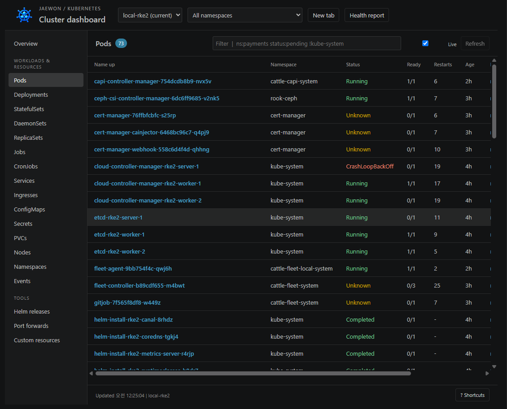
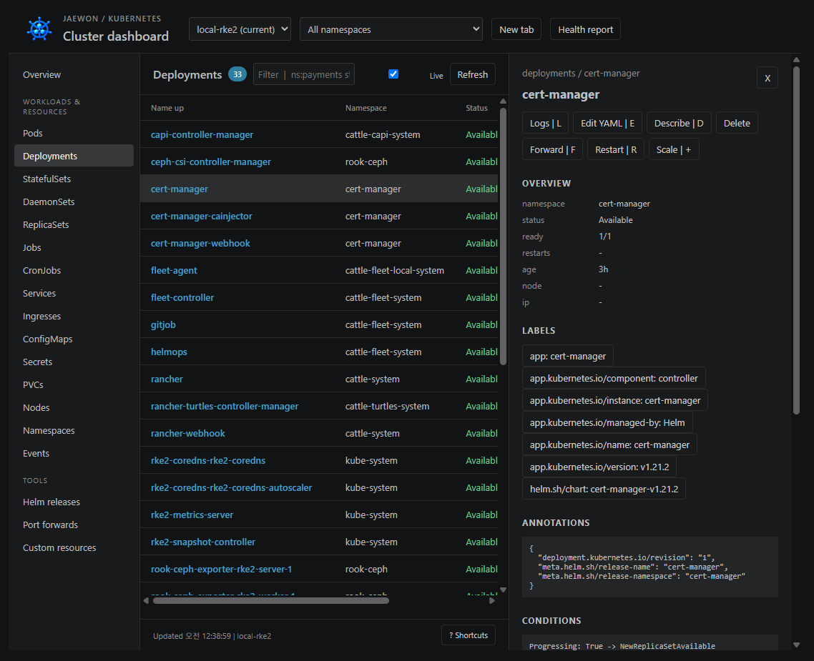
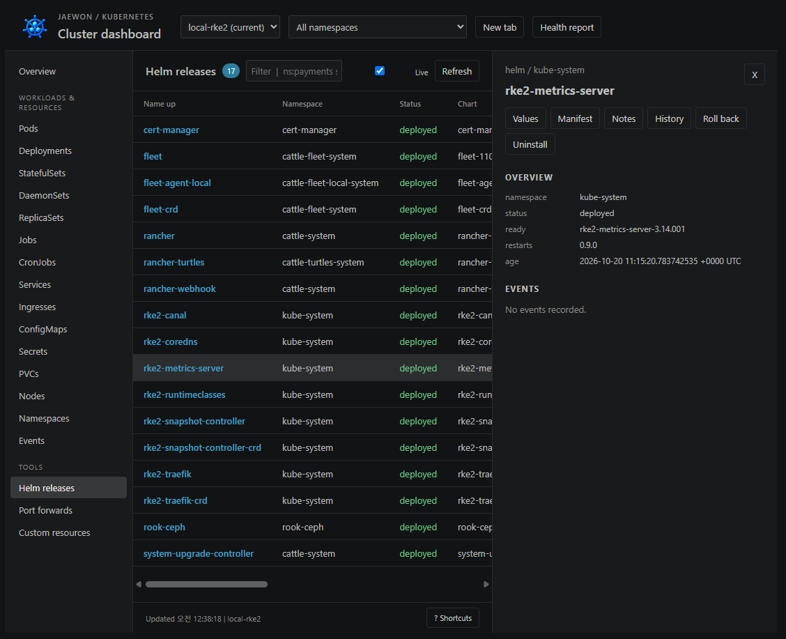

# Jaewon K8s Dashboard

[한국어](https://github.com/david365-lee/jaewon-k8s-dashboard/blob/main/README.md) · [English](https://github.com/david365-lee/jaewon-k8s-dashboard/blob/main/README.en.md) · [日本語](https://github.com/david365-lee/jaewon-k8s-dashboard/blob/main/README.ja.md) · [简体中文](https://github.com/david365-lee/jaewon-k8s-dashboard/blob/main/README.zh-CN.md)

VS Code 内で動作する独立した Kubernetes ダッシュボードです。

韓国の開発者 **jaewon** が制作し、無料で配布している拡張機能です。MIT ライセンスで提供します。

[Marketplace からインストール](https://marketplace.visualstudio.com/items?itemName=jaewon-lee.jaewon-k8s-dashboard) · [VSIX をダウンロード](https://github.com/david365-lee/jaewon-k8s-dashboard/releases/latest) · [プロジェクト案内](https://github.com/david365-lee/jaewon-k8s-dashboard#readme)

## 0.3.2: 多言語ドキュメントと拡張機能の詳細ページ

英語・日本語・中国語の README を、韓国語ガイドと同じ構成に更新しました。3 言語すべてで、クイックスタート、実際の画面 3 枚、機能別の操作、接続の復旧、設定、分析範囲を説明しています。上部の言語リンクから読みたいドキュメントを選択してください。

## 0.3.0: ローカル・リモートクラスタと StorageClass

**Connect Local / Remote** から、既存の kubeconfig、またはリモート API アドレスと Bearer Token／PEM 証明書・秘密鍵・CA を使って接続できます。認証情報は VS Code SecretStorage に保存します。StorageClass の作成・参照・YAML 編集・削除・デフォルトクラスの変更と、PV/PVC のストレージ詳細に対応しています。リモート API に到達できるネットワークが必要です。SSH トンネルは自動作成しません。

[接続とストレージの利用ガイド](https://github.com/david365-lee/jaewon-k8s-dashboard/blob/main/docs/remote-storage.md)

## クイックスタート

1. VS Code 1.90.0 以降、`kubectl`、接続先クラスタの kubeconfig を用意します。Helm 機能には `helm` も必要です。
2. VS Code の拡張機能画面で **Jaewon K8s Dashboard** を検索し、拡張機能 ID が `jaewon-lee.jaewon-k8s-dashboard` であることを確認してインストールします。
3. ターミナルで `kubectl config get-contexts` と `kubectl get namespaces` を実行し、接続を確認します。

コマンドパレットから **Jaewon K8s: Open Dashboard** を実行するか、**Ctrl+Alt+J** を押してください。左側のアクティビティバーにある Jaewon K8s からも、クラスタとポートフォワードを管理できます。

macOS のショートカットは **Cmd+Alt+J** です。アクティビティバーに表示されない場合は **Jaewon K8s: Show Sidebar** を実行してください。

## 機能

### 0.2.4 アップデート

詳細ページで表示できなかった画像を差し替え、実際の利用画面 3 枚と機能別の説明を追加しました。配布版の画像は Marketplace から直接配信するため、GitHub にログインせずに閲覧できます。接続の復旧、名前空間の復元、コンテナ状態の改善も含まれます。

### 0.2.2 アップデート

- 初回接続に失敗した後も、手動・自動更新で接続設定と名前空間の取得を再試行します。
- 拡張機能・ダッシュボード・タブのアイコンを新しい青色のクラスタ画像に変更し、アクティビティバーのアイコンも統一しました。
- 接続失敗の原因をステータスバーに表示します。API サーバーや SSH トンネルが停止している場合は、その接続を復旧してください。

### 0.2.0 の改善

Pod の現在の障害と過去の再起動履歴を区別し、init・サイドカーの準備状態を反映します。詳細画面では通常・init・一時コンテナ、ワークロードテンプレート、前回の終了理由を確認できます。ダッシュボードのタブ復元、非表示画面の自動更新停止、集合ベースのラベル条件を維持したシェル対象選択を追加しました。生成したアイコンはダッシュボードのヘッダーとタブにも表示します。

[REA 詳細分析と検証記録](https://github.com/david365-lee/jaewon-k8s-dashboard/blob/main/docs/rea-expansion-0.2.0.md)

- コンテキストごとの独立タブ、名前空間の選択、リソースの検索・並べ替え・ページ移動
- Pods、Deployments、StatefulSets、DaemonSets、ReplicaSets、Jobs、CronJobs、Services、Ingresses、ConfigMaps、Secrets、PVCs、Nodes、Namespaces、Events、CRDs
- コンテナ・条件・イベント・ラベル・アノテーション・Secret の個別キー、CPU／メモリ履歴と制限値の確認
- 複数 Pod／コンテナのリアルタイムログ、過去ログ、フィルター・正規表現・強調・コピー・保存
- コンテナシェル、YAML 編集／適用、再起動・スケール・削除、CronJob の実行／停止、ノードの cordon／uncordon
- 自動再接続・保存・自動起動に対応したポートフォワード（`127.0.0.1` にバインド）
- Helm のリリース・values・manifest・notes・history・rollback・uninstall
- 障害 Pod、再起動回数、準備できていないワークロード／ノードをまとめた Markdown 状態レポート

## 画面ガイド

以下は、2026 年 10 月 21 日にユーザーから提供された、実際の `local-rke2` クラスタの画面です。撮影時点の状態を示しており、現在のクラスタが正常かどうかを示すものではありません。リソース名・件数・状態は接続環境によって異なります。

### リソースの探索と状態確認

コンテキストと名前空間を選択し、リソースを検索・並べ替えます。Pod の現在の障害と過去の終了履歴を区別し、コンテナの準備状態・再起動回数・ノード・IP を確認します。

- **Context / Namespace**: 上部でクラスタと取得範囲を選択します。**New tab** で別のクラスタを独立したタブに表示できます。
- **Status / Ready / Restarts**: 現在の状態、準備済みコンテナ数、累積再起動回数を併せて確認します。`Running` でも `Ready` が `0/1` なら準備できていません。`Completed` はジョブの完了を示します。
- **Unknown / CrashLoopBackOff**: ノード接続とコンテナ状態を確認した後、そのリソースのログ・Describe・イベントで原因を調査します。画像内の障害表示は撮影時点の記録です。
- **検索 / 更新**: `ns:payments`、`status:pending`、`!kube-system` などのフィルターを組み合わせます。**Live** で自動更新、**Refresh** ですぐに再取得できます。
- **Health report**: 準備できていないリソースや障害 Pod を Markdown レポートで確認します。

### Deployment の詳細とリソース操作

一覧の名前を選択すると、右側に詳細パネルが開きます。以下は `cert-manager` Deployment の詳細画面です。

- **Overview**: 名前空間、状態、準備済みレプリカ数、作成からの経過時間を確認します。
- **Labels / Annotations / Conditions / Events**: セレクター、Helm の管理情報、ワークロードの条件、イベントを確認します。コンテナ領域には通常・init・一時コンテナのイメージ・リソース・現在の状態・前回の終了理由を表示します。
- **Logs / Edit YAML / Describe**: ログの表示、YAML の編集・適用、kubectl による詳細診断を実行します。
- **Restart / Scale / Delete**: ワークロードの再起動、レプリカ数の変更、リソースの削除を実行します。利用できる操作はリソースの種類と RBAC 権限によって異なります。
- **Forward**: 対応するリソースのポートをローカルに接続します。パネルの **X** で詳細表示を閉じます。

### Helm リリースの管理

左側の **Helm releases** を選択すると、リリース一覧を取得します。以下は `kube-system` の `rke2-metrics-server` リリースです。

- **Values / Manifest / Notes**: インストール値、デプロイ済み Kubernetes 定義、チャートの利用案内を開きます。
- **History / Roll back**: デプロイ履歴を確認し、選択したリビジョンに戻します。
- **Uninstall**: 確認後に選択したリリースを削除します。接続先クラスタに対して `helm` を実行でき、必要な権限があることが前提です。
- リリース一覧には名前空間・デプロイ状態・チャート情報を表示します。Helm の詳細項目はリソース詳細と異なる場合があるため、バージョンや設定の正確な値は **Values**、**Manifest**、**History** で確認してください。

### 複数コンテナのリアルタイムログ

複数の Pod とコンテナのログをまとめて表示し、過去ログ・検索・正規表現・強調・コピー・保存を利用できます。

### ポートフォワード

**Port forwards** でローカル接続を管理します。ポートフォワードは `127.0.0.1` にバインドし、保存・停止・再起動・ブラウザーで開く操作に対応します。保存した接続の自動起動は `jaewonK8s.autoStartPortForwards` で設定します。

## 接続設定と復旧

- 標準ではローカルの `kubectl` と、環境変数 `KUBECONFIG` またはホームディレクトリの `.kube/config` を使います。別のファイルは `jaewonK8s.kubeconfig` に指定してください。
- k9s で `--kubeconfig` を指定している場合は、同じファイルを設定し、同じコンテキストを選択してください。別の `kubectl` が必要な場合は `jaewonK8s.kubectlPath` を指定します。
- 初回接続に失敗した後、**Refresh** を押すか **Live** 自動更新を有効にすると、設定・コンテキスト・名前空間の取得を再試行します。
- API アドレスが `127.0.0.1` で接続を拒否された場合は、クラスタ接続に使うローカルサービスや SSH トンネルが動作しているか確認してください。ダッシュボードはトンネルを自動作成しません。
- 同じ kubeconfig とコンテキストで `kubectl --context <コンテキスト> get namespaces` が成功するか確認してください。リソースの参照と操作には、そのユーザーの RBAC 権限が適用されます。

## 設定

ローカルの `kubectl` と kubeconfig を使用します。Helm 機能には `helm` 実行ファイルが必要です。VS Code 設定で `jaewonK8s.kubectlPath`、`jaewonK8s.helmPath`、`jaewonK8s.kubeconfig` を指定できます。その他の設定は `jaewonK8s.refreshSeconds`、`metrics`、`logTailLines`、`logMaxLines`、`autoStartPortForwards` です。

すべてのクラスタ操作で選択したコンテキストを明示します。kubectl のデフォルトコンテキスト変更は別のコマンドです。削除・YAML 適用・Helm rollback/uninstall は実行前に確認します。各操作には既存の kubeconfig の RBAC が適用されます。

## インストールと開発

`npm run package` で生成した VSIX を、VS Code の **Extensions: Install from VSIX...** からインストールします。その後 **Developer: Reload Window** を実行すると、新しい拡張機能が読み込まれます。

外部のランタイム依存関係やビルド工程を必要とせず、Node.js CommonJS と VS Code webview を使用します。`npm test` でコマンド引数・セレクター・操作の検証テストを実行できます。

## 分析範囲

インストール済みの utiltools Kubernetes Dashboard 1.0.4 を REA で静的に分析し、manifest/README に記載された機能を独立して実装しました。元のコードや素材は含みません。元の拡張機能と実行結果が完全に同等であることは検証していません。テーブルは 150 行単位のページ方式で、メトリクス履歴は詳細画面を開いている間に収集します。分析の根拠と制限は `docs/` を参照してください。
