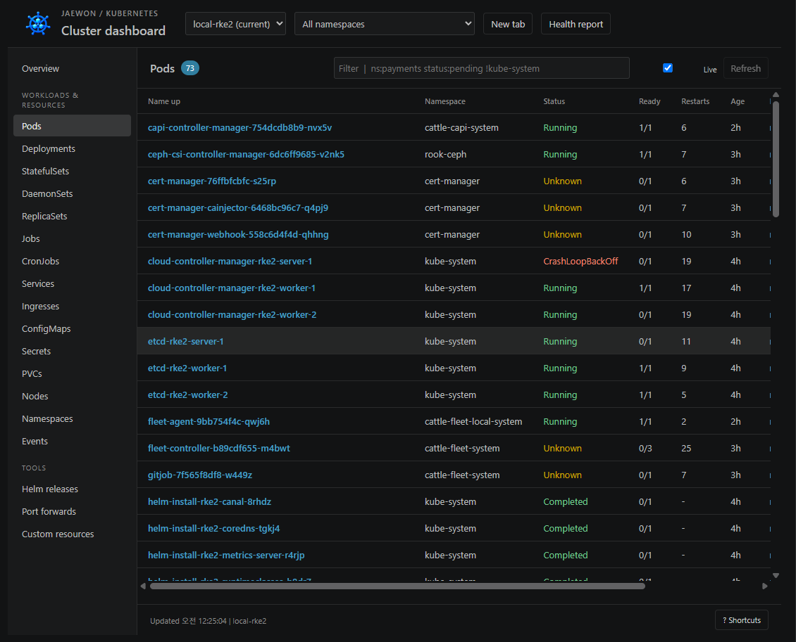
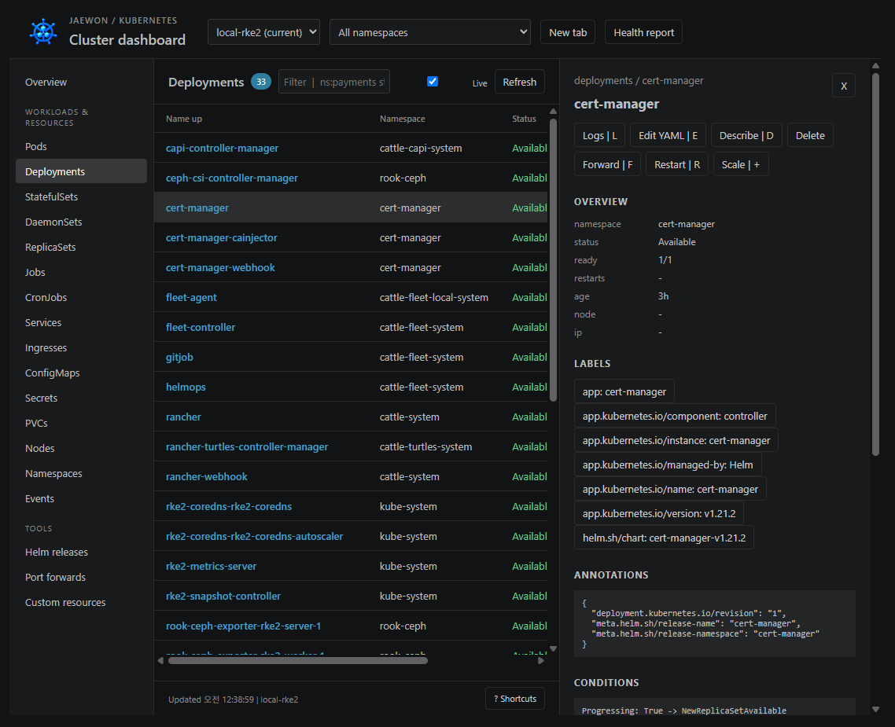
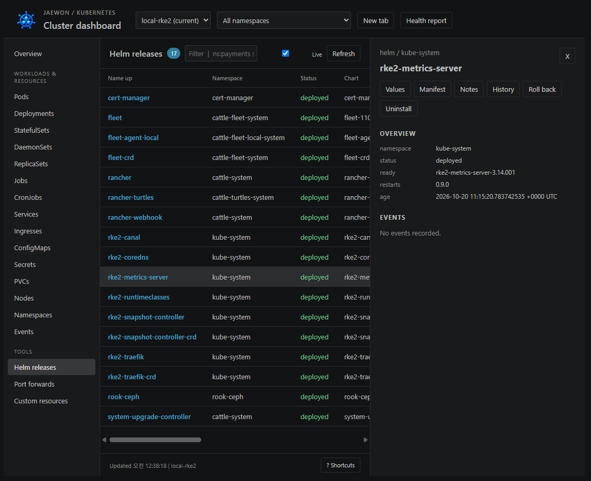

# Jaewon K8s Dashboard

[한국어](https://github.com/david365-lee/jaewon-k8s-dashboard/blob/main/README.md) · [English](https://github.com/david365-lee/jaewon-k8s-dashboard/blob/main/README.en.md) · [日本語](https://github.com/david365-lee/jaewon-k8s-dashboard/blob/main/README.ja.md) · [简体中文](https://github.com/david365-lee/jaewon-k8s-dashboard/blob/main/README.zh-CN.md)

在 VS Code 中运行的独立 Kubernetes 仪表板。

由韩国开发者 **jaewon** 制作并免费分发，采用 MIT 许可证。

[从 Marketplace 安装](https://marketplace.visualstudio.com/items?itemName=jaewon-lee.jaewon-k8s-dashboard) · [下载 VSIX](https://github.com/david365-lee/jaewon-k8s-dashboard/releases/latest) · [项目介绍](https://github.com/david365-lee/jaewon-k8s-dashboard#readme)

## 0.3.2：多语言文档与扩展详情页

英文、日文和中文 README 已按韩文指南的相同结构更新。三种语言均包含快速开始、3 张实际截图、各功能操作、连接恢复、设置和分析范围。请通过顶部语言链接选择所需文档。

## 0.3.0：本地、远程集群与 StorageClass

通过 **Connect Local / Remote**，使用现有 kubeconfig，或使用远程 API 地址及 Bearer Token／PEM 证书、私钥和 CA 连接集群。凭据保存在 VS Code SecretStorage 中。支持创建、查看、编辑 YAML 和删除 StorageClass，修改默认存储类，以及查看 PV/PVC 存储详情。网络必须能够访问远程 API；不会自动创建 SSH 隧道。

[连接与存储使用指南](https://github.com/david365-lee/jaewon-k8s-dashboard/blob/main/docs/remote-storage.md)

## 快速开始

1. 准备 VS Code 1.90.0 或更高版本、`kubectl` 和目标集群的 kubeconfig。Helm 功能还需要 `helm`。
2. 在 VS Code 扩展视图中搜索 **Jaewon K8s Dashboard**，确认扩展 ID 为 `jaewon-lee.jaewon-k8s-dashboard` 后安装。
3. 在终端运行 `kubectl config get-contexts` 和 `kubectl get namespaces`，确认连接正常。

从命令面板运行 **Jaewon K8s: Open Dashboard**，或按 **Ctrl+Alt+J**。也可以通过左侧活动栏中的 Jaewon K8s 管理集群和端口转发。

macOS 快捷键为 **Cmd+Alt+J**。如果活动栏中没有显示，请运行 **Jaewon K8s: Show Sidebar**。

## 功能

### 0.2.4 更新

替换详情页中无法显示的图片，新增 3 张实际使用截图和各功能的操作说明。发布版本的图片由 Marketplace 直接提供，无需登录 GitHub 即可查看。同时包含连接恢复、命名空间恢复和容器状态方面的改进。

### 0.2.2 更新

- 首次连接失败后，可通过手动刷新或自动刷新重新尝试读取连接配置和命名空间。
- 将扩展、仪表板和标签页图标更新为新的蓝色集群图片，并统一活动栏图标。
- 在状态栏显示连接失败的原因。如果 API 服务器或 SSH 隧道已停止，需要先恢复对应连接。

### 0.2.0 改进

区分 Pod 当前故障与历史重启记录，并考虑 init 容器和边车容器的就绪状态。详情页可查看普通、init 和临时容器、工作负载模板以及上次终止原因。新增仪表板标签页恢复、隐藏视图暂停自动刷新，以及保留集合型标签选择条件的 Shell 目标选择。生成的图标也会显示在仪表板标题栏和标签页中。

[REA 深入分析与验证记录](https://github.com/david365-lee/jaewon-k8s-dashboard/blob/main/docs/rea-expansion-0.2.0.md)

- 按上下文划分的独立标签页，命名空间选择，资源搜索、排序和分页
- Pods、Deployments、StatefulSets、DaemonSets、ReplicaSets、Jobs、CronJobs、Services、Ingresses、ConfigMaps、Secrets、PVCs、Nodes、Namespaces、Events、CRDs
- 查看容器、条件、事件、标签、注解、Secret 单个键、CPU／内存历史和资源限制
- 多 Pod／容器实时日志、历史日志、过滤、正则表达式、高亮、复制和保存
- 容器 Shell、YAML 编辑与应用、重启、扩缩容、删除、CronJob 运行与暂停、节点 cordon／uncordon
- 支持自动重连、保存和自动启动的端口转发，绑定 `127.0.0.1`
- Helm 发布、values、manifest、notes、history、rollback、uninstall
- 汇总故障 Pod、重启次数和未就绪工作负载／节点的 Markdown 健康报告

## 界面说明

以下图片由用户于 2026 年 10 月 21 日提供，展示实际的 `local-rke2` 集群。图片仅反映截图时的状态，不能说明集群当前是否正常。资源名称、数量和状态会因连接环境而异。

### 浏览资源与检查状态

选择上下文和命名空间，搜索并排序资源。区分 Pod 当前故障与历史终止记录，查看容器就绪状态、重启次数、节点和 IP 地址。

- **Context / Namespace**：在顶部选择集群和查询范围。使用 **New tab** 在独立标签页中查看另一个集群。
- **Status / Ready / Restarts**：结合当前状态、就绪容器数和累计重启次数进行判断。即使为 `Running`，若 `Ready` 为 `0/1`，仍表示尚未就绪。`Completed` 表示任务已完成。
- **Unknown / CrashLoopBackOff**：先检查节点连接和容器状态，再通过对应资源的日志、Describe 和事件调查原因。截图中的故障标记是拍摄当时的记录。
- **搜索 / 刷新**：组合使用 `ns:payments`、`status:pending`、`!kube-system` 等过滤条件。**Live** 用于自动刷新，**Refresh** 用于立即重新查询。
- **Health report**：以 Markdown 报告查看未就绪资源和故障 Pod。

### Deployment 详情与资源操作

选择列表中的名称即可在右侧打开详情面板。下图展示 `cert-manager` Deployment 的详细信息。

- **Overview**：查看命名空间、状态、就绪副本数和创建后的经过时间。
- **Labels / Annotations / Conditions / Events**：查看选择器、Helm 管理信息、工作负载条件和事件。容器区域显示普通、init 和临时容器的镜像、资源、当前状态和上次终止原因。
- **Logs / Edit YAML / Describe**：打开日志，编辑和应用 YAML，运行 kubectl 详细诊断。
- **Restart / Scale / Delete**：重启工作负载、修改副本数或删除资源。可用操作取决于资源类型和 RBAC 权限。
- **Forward**：将支持的资源端口连接到本地。点击面板的 **X** 关闭详情。

### 管理 Helm 发布

选择左侧的 **Helm releases** 查看发布列表。下图展示 `kube-system` 中的 `rke2-metrics-server` 发布。

- **Values / Manifest / Notes**：打开安装参数、已部署的 Kubernetes 定义和 Chart 使用说明。
- **History / Roll back**：查看部署历史并回退到选定修订版本。
- **Uninstall**：确认后移除所选发布。必须能够针对已连接集群运行 `helm`，并具备所需权限。
- 发布列表显示命名空间、部署状态和 Chart 信息。Helm 详情面板的字段可能与资源详情不同；请通过 **Values**、**Manifest** 和 **History** 确认准确的版本和配置值。

### 多容器实时日志

汇总多个 Pod 和容器的日志，支持历史日志、搜索、正则表达式、高亮、复制和保存。

### 端口转发

在 **Port forwards** 中管理本地连接。端口转发绑定 `127.0.0.1`，支持保存、停止、重启和在浏览器中打开。通过 `jaewonK8s.autoStartPortForwards` 配置已保存连接的自动启动。

## 连接配置与恢复

- 默认使用本地 `kubectl`，以及环境变量 `KUBECONFIG` 或用户主目录中的 `.kube/config`。如需使用其他文件，请设置 `jaewonK8s.kubeconfig`。
- 如果在 k9s 中通过 `--kubeconfig` 选择文件，请在此设置相同文件并选择相同上下文。如需指定其他 `kubectl` 可执行文件，请设置 `jaewonK8s.kubectlPath`。
- 首次连接失败后，点击 **Refresh** 或开启 **Live** 自动刷新，会重新尝试读取配置、上下文和命名空间。
- 如果 API 地址为 `127.0.0.1` 且连接被拒绝，请检查访问集群所需的本地服务或 SSH 隧道是否正在运行。仪表板不会自动创建该隧道。
- 使用同一 kubeconfig 和上下文确认 `kubectl --context <上下文> get namespaces` 能否成功。资源查询与操作遵循该用户的 RBAC 权限。

## 设置

使用本地 `kubectl` 和 kubeconfig。Helm 功能需要 `helm` 可执行文件。可在 VS Code 设置中指定 `jaewonK8s.kubectlPath`、`jaewonK8s.helmPath` 和 `jaewonK8s.kubeconfig`。其他设置包括 `jaewonK8s.refreshSeconds`、`metrics`、`logTailLines`、`logMaxLines` 和 `autoStartPortForwards`。

所有集群操作都会明确指定选定上下文。更改 kubectl 默认上下文需要使用单独的命令。删除、应用 YAML、Helm rollback/uninstall 都会在执行前要求确认。每项操作均遵循现有 kubeconfig 的 RBAC 权限。

## 安装与开发

运行 `npm run package` 生成 VSIX，然后在 VS Code 中通过 **Extensions: Install from VSIX...** 安装。安装后运行 **Developer: Reload Window** 以加载新扩展。

使用 Node.js CommonJS 和 VS Code webview，无需外部运行时依赖或构建步骤。运行 `npm test` 可测试命令参数、选择器和操作验证。

## 分析范围

使用 REA 对已安装的 utiltools Kubernetes Dashboard 1.0.4 进行了静态分析，并独立实现其 manifest/README 中描述的功能。不包含原始代码和素材，尚未验证与原扩展的执行结果完全等价。表格按每页 150 行分页，指标历史在详情页打开期间采集。分析依据与限制请参阅 `docs/`。
